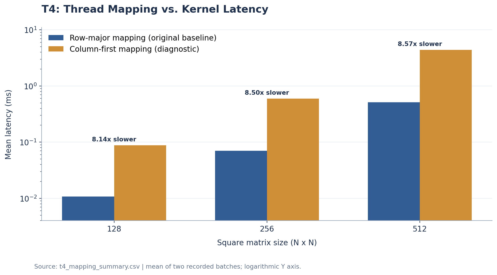
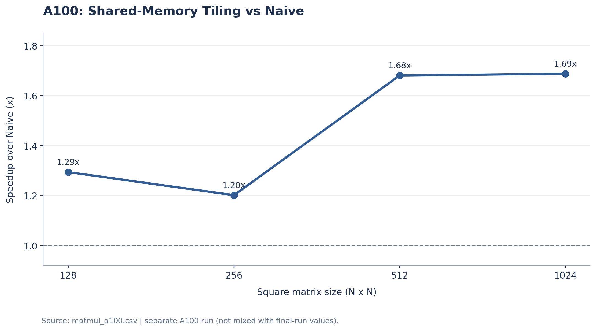
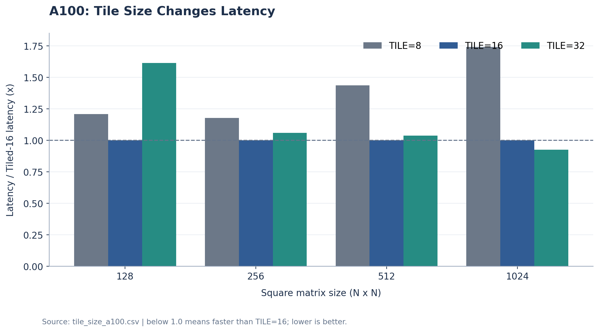
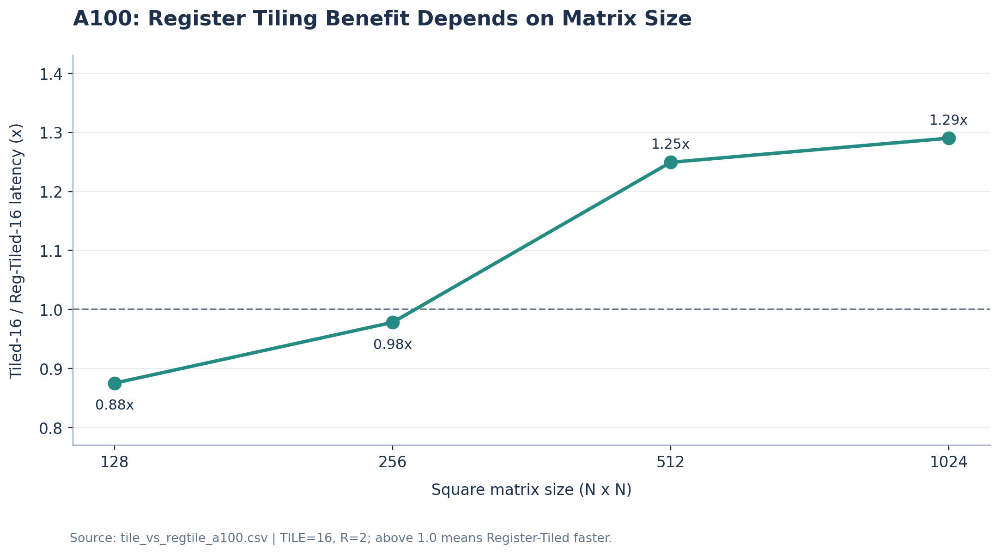
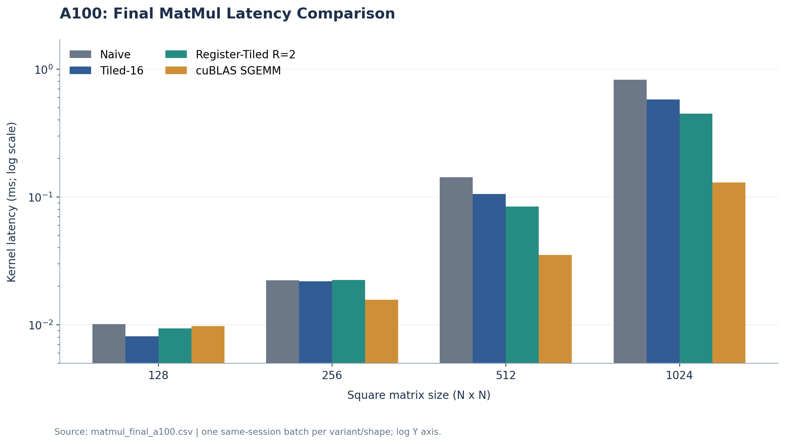
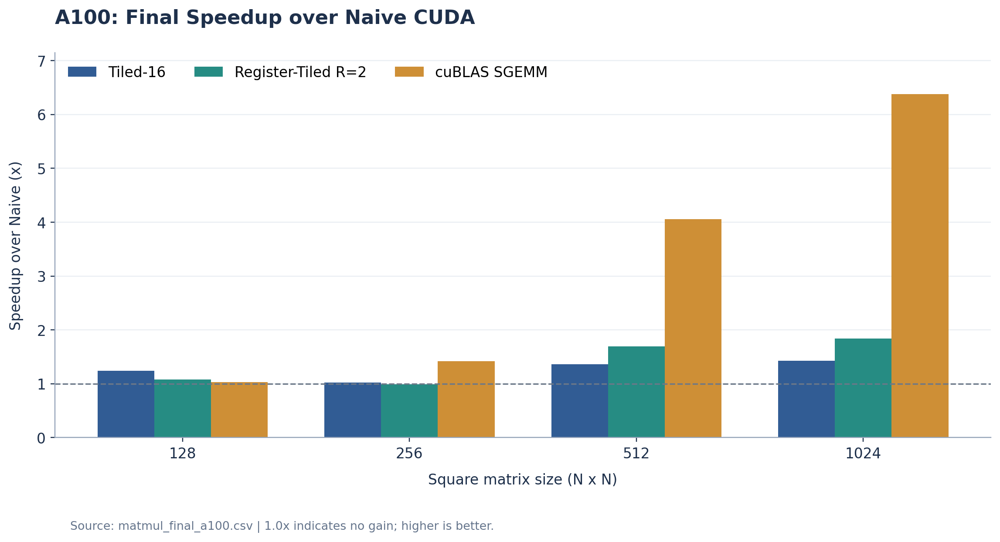
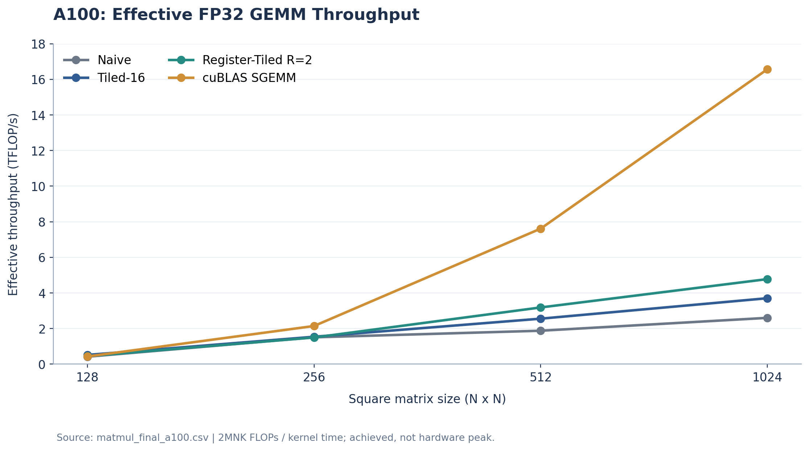

# 从 Naive CUDA 到 Register Tiling：GPU MatMul 的硬件感知优化实验报告

**Project A — CUDA Kernel Library for Transformer Workloads**  
**研究主题：** Hardware-Aware FP32 Matrix Multiplication Optimization  
**报告版本：** 2026-10-22  
**课程关联：** 《计算机组成原理》“新硬件体系结构下的高性能算子编译优化”（第 6、7、8 章）  
**研究平台：** NVIDIA T4（线程映射分析）、NVIDIA A100（后续优化及最终对照）

> 本文针对已经实现的 CUDA Kernel 和真实 Benchmark 进行复盘。**T4 线程映射实验是机制验证，而不是一次从低效映射到高效映射的实际优化。** A100 的不同实验批次也不直接拼接为同一次公平对照；最终主结论以同批次四版本 Benchmark 为准。

## 摘要

本项目从 CPU Reference 与一线程计算一个输出元素的 **Naive CUDA MatMul** 出发，依次研究了线程映射与 Memory Coalescing、Block 内 Shared-Memory Tiling、Tile Size 与 GPU 资源约束、单线程多输出的 Register Tiling，最后用 **cuBLAS SGEMM** 作为工业级性能参考，构成从硬件机制、代码实现、正确性验证到性能评估的完整闭环。

- 在 T4 上，刻意构造的 Column-first 映射比原本已采用 Row-major 映射的 Naive Kernel **慢 8.14× / 8.50× / 8.57×**（128² / 256² / 512²，按每种映射两次记录的平均延迟比较）。这说明线程与数据的对应关系会显著影响访存效率，但**不应记作 8× 优化收益**。
- 在 A100 的独立中间实验中，`TILE=16` 的 Shared-Memory Tiling 相比 Naive 在 1024² 上达到 **1.688× 加速**；Tile Size 扫描进一步表明最优参数随矩阵规模变化。
- Register-Tiled（`R=2`，一个线程计算同一行两个输出）在较大矩阵上优于普通 Tiled，但在较小矩阵上可能更慢。**这与“数据复用能省流量，但不保证降低总执行时间”的性能模型一致。**
- **最终同批次 A100 对照：** 在 1024² 上，Naive 为 **0.8264 ms**，Tiled-16 为 **0.5801 ms**，Register-Tiled-16 为 **0.4497 ms**，cuBLAS SGEMM 为 **0.1296 ms**。自己实现的最佳候选相对 Naive **加速 1.84×（耗时降低约 45.6%）**；cuBLAS 比该候选还快 **3.47×**。

这份结果说明：项目已经实现了有实证支撑的多层次数据复用优化，同时揭示优化效果具有**规模依赖性、资源权衡和成熟库性能差距**。

---

## 1. 研究问题、对象与实验原则

### 1.1 问题定义

考虑连续存储的 FP32 矩阵乘法：

$$
A\in\mathbb{R}^{M\times K},\quad
B\in\mathbb{R}^{K\times N},\quad
C=AB\in\mathbb{R}^{M\times N}.
$$

其单个输出为

$$C_{ij}=\sum_{k=0}^{K-1} A_{ik}B_{kj}.$$

本项目研究的问题不是“能不能调用 GPU 完成 MatMul”，而是：在数学目标不变的前提下，**线程映射、存储层次和数据复用策略如何影响 Kernel 的效率**？

具体研究线索：

1. 线程如何映射到连续地址？——**Memory Coalescing**。
2. 多个输出共同需要同一份输入时，如何避免重复 Global Load？——**Shared-Memory Tiling**。
3. Tile 变大是否必然更快？——**资源预算、Occupancy 和 Grid Parallelism**。
4. 一个线程能否同时计算多个输出，以继续复用操作数？——**Register Tiling / Thread Coarsening**。
5. 自己的实现距离成熟库还有多远？——**cuBLAS SGEMM 对照**。

### 1.2 对照与计量

- **正确性：** CPU FP32 Reference 是数值参考；Naive、Tiled（8/16/32）、Register-Tiled（R=2）与 cuBLAS 均在先前的独立测试中报告 `PASS`，包含非方阵与非整除的边界测试。不同求和次序允许小范围浮点误差。
- **性能：** 只统计设备端计算的 CUDA Event 区间，排除 `cudaMalloc`、Host↔Device 复制、CPU Reference 与 cuBLAS Handle 创建时间。
- **核心指标：** Kernel 延迟（ms，越低越好）、有效吞吐量（GFLOP/s，越高越好）与相对加速比。
- **计算约定：** 每次乘加约计 2 FLOPs，因此 FLOPs 约为 $2MNK$：

$$
\mathrm{GFLOP/s}=\frac{2MNK}{t_{\mathrm{ms}}\cdot10^6},\qquad
\mathrm{Speedup}(X\mid B)=\frac{t_B}{t_X}.
$$

> 这些是 **Kernel-only、固定输入反复执行时的平均延迟**，不是包含数据传输的端到端应用吞吐，也不是硬件峰值算力。文内“更快”均限定在对应 GPU、输入形状、编译/计时配置和实验样本中。

### 1.3 实现演化概览

| 阶段 | 核心实现 | 研究/优化目标 | 阶段性质 |
|---|---|---|---|
| 0 | CPU Reference → Naive CUDA | 建立正确性与 GPU Baseline | 基础实现 |
| 1 | Row-major vs Column-first | 验证 Thread Mapping 与访存合并 | **机制诊断**；非实际加速 |
| 2 | Shared-Memory Tiled | Block 内显式加载并复用 A、B Tile | 第一次实质优化 |
| 3 | TILE=8/16/32 | 探究复用、SM 驻留资源与 Grid 并行的权衡 | 参数化与设计研究 |
| 4 | Register-Tiled，R=2 | 每线程两输出，复用 A 操作数并减少部分跨 Block 加载 | 第二层实质优化 |
| 5 | cuBLAS SGEMM | 对照成熟的工业库实现 | 外部性能参考 |
| 6 | Final A100 Benchmark | Naive / Tiled / Reg-Tiled / cuBLAS 同批次比较 | **Milestone 02 综合验收** |

---

## 2. Baseline：CPU Reference 与 Naive CUDA

### 2.1 优化思想与实现原则

本阶段不追求性能技巧，而是建立一个数学语义明确、可被复用的计算基准。

CPU Reference 采用三重循环得到 $C_{ij}$；Naive CUDA 将输出矩阵中的每个 $C_{ij}$ 分配给一个线程，每个线程沿 K 维独立累加。

伪代码：

```cpp
int i = /* 当前线程负责的 C 行 */;
int j = /* 当前线程负责的 C 列 */;
float acc = 0.0f;
for (int k = 0; k < K; ++k) {
    acc += A[i * K + k] * B[k * N + j];
}
C[i * N + j] = acc;
```

三个线性下标的区别由 Row-major 行跨度决定：A 的行跨度是 K，而 B、C 的行跨度是 N。

### 2.2 机制与局限

这个实现容易验证，但从程序表达的逻辑加载看，每个输出在 K 维读取 K 个 A 和 K 个 B：

$$L_{\mathrm{naive}}\approx 2MNK\quad\text{次逻辑输入加载}.$$

同一份 $A_{ik}$ 会参与 N 个不同输出，同一份 $B_{kj}$ 会参与 M 个不同输出。**逻辑加载重复不等于相同比例的 DRAM 事务**：L1/L2 Cache 和 Warp 内同地址访问处理会消除部分实际显存流量。

**结果：** CPU Reference 与 Naive CUDA 通过正确性验证，建立后续实验共用的功能基线。Baseline 自身的性能以第 8 节的 A100 最终同批次数据为准。

---

## 3. Milestone 01：Thread Mapping 与 Memory Coalescing（T4）

### 3.1 研究动机与优化可能性

Naive MatMul 的计算式不变，但 GPU 的 Warp 通常由相邻线程共同发射访存指令。假设一个 Warp 的线程负责**同一行 C 的连续列**，对固定 k：

- A：线程访问同一个 $A_{ik}$，形成相同地址请求；
- B：线程访问 $B_{k,j},B_{k,j+1},\ldots$，地址连续；
- C：最终写入同一行的连续输出地址。

这种 **Row-major 输出映射**适合访存合并（Coalescing）。如果将连续线程优先映射到不同的输出行，在 N、K 较大时，部分地址会呈现跨行大步幅，可能导致更多内存事务和更差的执行效率。

**实际情况：** 最早的 Naive CUDA 已经使用 Row-major 映射，没有先经历错误的映射。因此实验刻意引入 Column-first 对照，是研究“如果映射不合理会怎样”，而不是把最初的算法从 Column-first 优化成 Row-major。

### 3.2 实验结果

数据来源：[`results/t4_mapping_summary.csv`](../results/t4_mapping_summary.csv)，每种映射与形状分别记录两次计时。下面是两次记录的算术均值。

| N（方阵） | Row-major（ms） | Column-first（ms） | Column-first / Row-major |
|---:|---:|---:|---:|
| 128 | 0.010806 | 0.087978 | **8.14× 更慢** |
| 256 | 0.070106 | 0.595926 | **8.50× 更慢** |
| 512 | 0.514695 | 4.409515 | **8.57× 更慢** |



**结果分析：** 对于相同的数学运算、相同输入尺寸，线程映射本身就能造成数量级明显的延迟差异，符合连续线程更适合连续地址访问的预期。这一结论证明了硬件感知映射设计的重要性。

**边界：** 未直接使用硬件性能计数器测量 Memory Transactions，因此 Coalescing 是有力的机制解释而非已独立证实的唯一原因；128 的 Row-major 两次时间分别为 0.013118 与 0.00849382 ms，存在明显测量差异。图中用对数纵轴仅为同时展示三个规模，不把其解释为比例不确定性已消失。

---

## 4. 优化一：Shared-Memory Tiling

### 4.1 为什么只做好 Coalescing 还不够？

Coalescing 回答“**当前 Warp 的一次访存请求是否规整**”，却没有直接回答“**同一份数据是否在不同线程的计算中被反复请求**”。矩阵乘法有天然的数据复用：一块 A 可用于多个输出列，一块 B 可用于多个输出行。

因此下一步将复用范围提升到 **Thread Block**：协作把输入 Tile 加载进 Shared Memory，再由 Block 内线程读取参与乘加。

### 4.2 算法设计与硬件机制

对 Output Tile $C_{T\times T}$，每轮沿 K 处理 T 个元素，加载：

$$A_{\mathrm{tile}}\in\mathbb{R}^{T\times T},\quad B_{\mathrm{tile}}\in\mathbb{R}^{T\times T}.$$

一个 Block 使用 $T\times T$ Threads，一个线程计算一个输出，所有线程分别加载 A、B 各一个元素；各线程的输出累加器 `sum` 保存在自身的寄存器中。

```text
for 每个 K-Tile p:
    各线程分别写入 Atile[ty][tx]、Btile[ty][tx]
    越界输入填 0
    __syncthreads()           # 保证新 Tile 已加载完成
    for q in [0, TILE):
        sum += Atile[ty][q] * Btile[q][tx]
    __syncthreads()           # 旧 Tile 用完，允许下一轮覆盖
写回有效的 C[row, col]
```

对于可整除的方阵，理想化的逻辑 Global Load 次数由 $2MNK$ 下降到约 $2MNK/T$，即最多体现 **T 倍输入加载指令数量差异**（忽略边界、缓存、其他负担）。这不是预测 T 倍加速：Shared Memory 读写、Barrier、索引和调度仍有成本；Naive 也可能命中硬件 Cache。

本项目实现了 K 维循环、独立 A/B 边界检查、Zero Padding、两次 Block Barrier 和最终写回。**TILE=16 时，两块输入 Tile 的静态 Shared Memory 占用为 $2\cdot16^2\cdot4=2048$ B（2 KiB/Block）。**

### 4.3 第一次 A100 Naive vs TILE=16 对照

数据来源：[`results/matmul_a100.csv`](../results/matmul_a100.csv)。这一批次与后续最终四版本综合对照**不是同一轮测量**。

| N | Naive（ms） | Tiled-16（ms） | 加速比 |
|---:|---:|---:|---:|
| 128 | 0.010134 | 0.007831 | 1.294× |
| 256 | 0.022031 | 0.018333 | 1.202× |
| 512 | 0.112568 | 0.066976 | 1.681× |
| 1024 | 0.790050 | 0.468167 | **1.688×** |



**结果分析：** 相比原始 Naive，Tiled-16 在四种规模上均出现较短延迟，尤其大矩阵上表现出更明显的复用收益。这验证了优化方向的有效性，但**没有验证性能增益的唯一物理来源**；不能把理论加载减少 16 倍直接等同于实际速度提升。

---

## 5. 参数化优化：Tile Size 与资源/并行度权衡

### 5.1 从固定 TILE=16 到编译期配置

Kernel 使用 `template<int TILE>`，在相同算法实现下生成 TILE=8、16、32 的专用版本。这既允许静态声明 Shared Memory，又为编译器提供固定循环边界等优化机会。由于测试端和实现端在不同 `.cu` 翻译单元，使用显式模板实例化，并在当前编译配置下通过 `-rdc=true` 完成跨文件构建。

对于当前的“一线程一输出”策略：

| TILE | Threads/Block | Warps/Block | Shared Memory/Block |
|---:|---:|---:|---:|
| 8 | 64 | 2 | 0.5 KiB |
| 16 | 256 | 8 | 2 KiB |
| 32 | 1024 | 32 | 8 KiB |

更大的 Tile 能提高 Block 内输入复用，但同时增加单 Block 的线程数、Shared Memory 用量，并减少 Grid 总 Block 数。**Occupancy（SM 驻留 Warp 的比例）不等于整个 GPU 有多少 SM 被分配了工作**；即使某个 Block 配置的理论 Occupancy 很高，Grid 太小仍可能只动用少数 SM。

编译器曾对 TILE=16 报告 `32 registers/thread`、`2048 bytes smem`、`0 spill loads/stores`。这些是特定编译设置下的静态资源信息，不能直接推出其他 TILE 或 Register-Tiled 的寄存器数量。

### 5.2 TILE=8/16/32 在 A100 上的轻量比较

数据来源：[`results/tile_size_a100.csv`](../results/tile_size_a100.csv)，根据本会话中实际运行输出整理。

| N | TILE=8（ms） | TILE=16（ms） | TILE=32（ms） | 本批次最快 |
|---:|---:|---:|---:|---|
| 128 | 0.009984 | **0.008253** | 0.013322 | 16 |
| 256 | 0.026040 | **0.022108** | 0.023439 | 16 |
| 512 | 0.152924 | **0.106414** | 0.110520 | 16 |
| 1024 | 1.010110 | 0.580178 | **0.537211** | 32 |



**结果分析：** TILE=16 在 128²–512² 最快，但 1024² 时 TILE=32 略占优势。对于 128²，TILE=32 只需 16 个 Block，在完整 A100 的多 SM 架构上可能存在 Grid Parallelism 不足；在 1024² 时仍有 1024 个 Block，可以更充分地分配工作，此时更大的输入复用可能抵消单 Block 的资源成本。

此处的资源/并行度分析是**与现象相符的合理机制解释**，没有用 Nsight 指标单独确认瓶颈。后续最终对照依然固定 **TILE=16**，用于在同一计算配置下清晰比较“一线程一输出”与“每线程两输出”，不把来自另一轮测量的 TILE=32 最佳数值混入最终排名。

---

## 6. 优化二：Register Tiling / Thread Coarsening（R=2）

### 6.1 新的复用目标

即使使用 Shared Memory，不同线程仍可能在计算相邻列的输出时读取相同的 A 操作数。如果让**同一线程计算同一行的两个输出**，便可以把一次从 Shared Memory 读到的 `a` 同时用于两个累加器：

$$C_{i,j}=\sum_k A_{ik}B_{kj},\quad C_{i,j+T}=\sum_k A_{ik}B_{k,j+T}.$$

当前设计使用 `R=2`，每个 Block 保留 $T\times T$ 线程，却负责一个 $T\times2T$ 的 Output Tile：

```cpp
row  = blockIdx.y * TILE + ty;
col0 = blockIdx.x * (2 * TILE) + tx;
col1 = col0 + TILE;

for (int q = 0; q < TILE; ++q) {
    float a = Atile[ty][q];
    sum0 += a * Btile[q][tx];
    sum1 += a * Btile[q][tx + TILE];
}
```

此处两列**相距 TILE**，而不是相邻两列；这样的列组映射保留了相邻 `tx` 对连续输出列的访问习惯。

协作加载相应调整为 $A_{\mathrm{tile}}:T\times T$、$B_{\mathrm{tile}}:T\times2T$；每个线程加载 1 个 A 和 2 个 B 操作数，同时需要分别判断两个输出边界。TILE=16 时 Shared Memory 从原来的 2 KiB/Block 增加到 **3 KiB/Block**。

### 6.2 理论节省与新增代价

若要计算相同的 $T\times2T$ 输出区域，且只看一个 K-Tile：

| | 普通 Tiled | Register-Tiled R=2 |
|---|---:|---:|
| Blocks | 2 | 1 |
| 有效输出个数 | $2T^2$ | $2T^2$ |
| A 逻辑 Global Load | $2T^2$ | $T^2$ |
| B 逻辑 Global Load | $2T^2$ | $2T^2$ |
| 合计逻辑 Global Load | $4T^2$ | $3T^2$ |

因此理论上，对于等量输出，**输入 Global Load 指令减少 25%**（忽略边界与缓存），并且一个 `a` 能在两个累加器之间复用。这里还发生了一个重要的变化：输出 Tile 加宽后，原本属于两个 Block 的部分 A 重复加载也消失了；并不是“寄存器能够跨 Block 共享”。

但增加了每线程累加器、Btile 宽度、地址/计算指令，每个 Block 计算量翻倍，同时 **Grid 的 Block 数量减半**。这些都可能抵消复用收益。

### 6.3 A100 配对对照：Tiled-16 vs Reg-Tiled-16

数据来源：[`results/tile_vs_regtile_a100.csv`](../results/tile_vs_regtile_a100.csv)，根据本会话中的独立配对实验整理。

| N | Tiled-16（ms） | Reg-Tiled-16（ms） | Reg 相对 Tiled 加速 |
|---:|---:|---:|---:|
| 128 | **0.007332** | 0.008376 | **0.875×（反而更慢）** |
| 256 | **0.019743** | 0.020183 | **0.978×（略慢）** |
| 512 | 0.096225 | **0.077025** | **1.249×** |
| 1024 | 0.672625 | **0.521370** | **1.290×** |



**结果分析：** 相同 TILE=16 下，R=2 在 128² 和 256² 没有带来收益，却在 512² 和 1024² 达到约 1.25×、1.29× 的加速。这是项目非常重要的**非单调优化结果**：一个理论上减少加载次数的方案，也可能因为并行组织和新开销而更慢。详细机制讨论见第 9 节。

---

## 7. 工业级参考：cuBLAS SGEMM

### 7.1 接入方法及正确性

传统 cuBLAS GEMM 采用 Column-major 数据解释，而本项目矩阵为连续 Row-major 存储。利用 $(AB)^\top=B^\top A^\top$，把原始 B、A 指针交换，便可在不额外转置/拷贝数据的情况下计算 Row-major 结果。

```cpp
// 原始 A 为 M×K、B 为 K×N，均为 Row-major
// alpha=1, beta=0
cublasSgemm(handle, CUBLAS_OP_N, CUBLAS_OP_N,
            N, M, K, &alpha,
            devB, N, devA, K,
            &beta, devC, N);
```

项目分别完成 `cublasCreate` / `cublasDestroy` 生命周期管理、cuBLAS API 状态检查和 CPU Reference 数值对照，测试报告 `PASS`。主要性能对照使用明确设置的 `CUBLAS_DEFAULT_MATH`，**并未显式启用 TF32 快速乘法模式**；不过没有使用指令级 profiler，故不声称对 cuBLAS 内部实际指令路径作了确认。

### 7.2 为什么把 cuBLAS 作为 Reference 而不是“优化版本”？

cuBLAS 是独立的、成熟的 BLAS 库，实现细节由 NVIDIA 根据架构和问题选择。把它列入结果，是回答“自写 CUDA 优化距离产业级 GEMM 还有多远”，**而不是把 cuBLAS 的吞吐量归功于自己实现的 Register Tiling**。

---

## 8. Milestone 02：A100 最终四版本综合对照

最终同批次数据来源：[`results/matmul_final_a100.csv`](../results/matmul_final_a100.csv)。四种实现使用相同矩阵形状和输入，在一次运行内依次计时；自写 Tiled/Reg-Tiled 固定 `TILE=16`，Reg-Tiled 固定 `R=2`。

### 8.1 Kernel 延迟

| N（方阵） | Naive（ms） | Tiled-16（ms） | Reg-Tiled-16（ms） | cuBLAS（ms） |
|---:|---:|---:|---:|---:|
| 128 | 0.010107 | **0.008131** | 0.009400 | 0.009789 |
| 256 | 0.022293 | 0.021842 | 0.022436 | **0.015677** |
| 512 | 0.143124 | 0.105155 | 0.084316 | **0.035267** |
| 1024 | 0.826388 | 0.580086 | 0.449700 | **0.129638** |



*注：图 5 采用对数纵轴，让小矩阵和大矩阵都可读；比较精确比例时应看表中数值或下方 Speedup 图。粗体仅标注该规模本次四种实现中的最短延迟。*

### 8.2 相对 Naive 的加速与最终增益

| N | Tiled / Naive | Reg-Tiled / Naive | cuBLAS / Naive | 本批次自写最佳 |
|---:|---:|---:|---:|---|
| 128 | **1.243×** | 1.075× | 1.032× | Tiled-16 |
| 256 | **1.021×** | **0.994×** | 1.422× | Tiled-16 |
| 512 | 1.361× | **1.697×** | 4.058× | Reg-Tiled-16 |
| 1024 | 1.425× | **1.838×** | 6.375× | Reg-Tiled-16 |



在 1024² 上：

- Naive → Tiled-16：**1.425×**。
- Tiled-16 → Reg-Tiled-16：**1.290×**。
- Naive → Reg-Tiled-16：**1.838×**，延迟降低 $(0.826388-0.449700)/0.826388\approx45.6\%$。
- cuBLAS 相比 Reg-Tiled 仍有 **3.469×** 的性能优势；Reg-Tiled 的有效吞吐量约为 cuBLAS 的 **28.8%**。

### 8.3 有效计算吞吐量

| N | Naive | Tiled-16 | Reg-Tiled-16 | cuBLAS |
|---:|---:|---:|---:|---:|
| 128 | 0.415 | 0.516 | 0.446 | 0.428 |
| 256 | 1.505 | 1.536 | 1.496 | 2.140 |
| 512 | 1.876 | 2.553 | 3.184 | 7.612 |
| 1024 | 2.599 | 3.702 | 4.775 | **16.565** |

*单位：TFLOP/s；根据日志中的 GFLOP/s 除以 1000 得到。*



**主结论：** 设计的复用机制在中大矩阵上确实实现了性能改进，但收益不是逐步严格单调的；对小矩阵，Tiled-16 甚至优于更复杂的 Reg-Tiled，而工业库则在大矩阵表现出更强的硬件利用能力。

---

## 9. 核心疑问：为什么 Reg-Tiled 有时比 Tiled，甚至比 Naive 更慢？

### 9.1 先确认现象到底有多大

不能把“多加载了一点，所以一定更慢/更快”当成规律；我们应该首先看**同一次运行中的差额**。

| 规模 | 记录来源 | Reg 相比 Tiled 延迟变化 | Reg 相比 Naive |
|---|---|---|---|
| 128² | 最终四版本 | **慢约 15.6%** | **快约 7.0%** |
| 256² | 最终四版本 | **慢约 2.7%** | **慢约 0.64%** |
| 512² | 最终四版本 | **快约 19.8%（耗时减少）** | **快约 41.1%** |
| 1024² | 最终四版本 | **快约 22.5%（耗时减少）** | **快约 45.6%** |

因此“Reg-Tiled 至少不应该比 Naive 慢”不是有效的性能保证：**在 256²，的确观测到了约 0.64% 的退化；不过这个差距非常小，在当前单批次实验下不能称为统计上显著的退化。** 128² 虽然比 Tiled 慢，却仍比 Naive 快。

### 9.2 机制一：Block 减半会改变 Grid Parallelism

TILE=16 时，两个版本的 Output Tile 分别为 16×16 与 16×32。全尺寸可整除时，Grid Block 数量为：

| N | Tiled-16 Blocks | Reg-Tiled-16 Blocks |
|---:|---:|---:|
| 128 | 64 | **32** |
| 256 | 256 | **128** |
| 512 | 1,024 | **512** |
| 1024 | 4,096 | **2,048** |

标准未分区 A100 有 108 个 SM [R3]。128² 的 Reg-Tiled 总共只有 32 个 Block，因此一次启动最多只能让 32 个 SM 获得工作；普通 Tiled 为 64 个 Block，同样不足以完全铺满所有 SM，但规模更大。到了 512²、1024²，两者都能够提供数百、数千个 Block，资源利用不足的影响通常减弱。

这里的论证指的是 **Grid 级并行不足**，并不是说 Reg-Tiled 的理论 SM Occupancy 一定低；前者关心“有多少 SM 有任务”，后者关心“一个 SM 可以驻留多少 Warp”。

### 9.3 机制二：Shared Memory 与 Cache 已经帮原版复用了很多数据

原 Tiled Kernel 的相邻线程可能在同一 Warp 内请求相同的 `Atile[ty][q]`。在共享内存地址相同的情况下，硬件支持 **Broadcast**，这类访问的实际成本不等于每个线程独立产生一次完整的内存事务 [R2]。

另一方面，A100 有规模较大的 L2 Cache（标准型号为 40 MB [R3]）。1024² 的 A、B 两个 FP32 输入合计约 8 MiB，**尺寸上可能位于 L2 容量之内**。是否真正命中还取决于缓存竞争、访问顺序和其他工作负载，不能把容量关系直接当成命中率证明。

因此，Register Tiling 减少了代码层面的 A 加载与 Shared Memory 读取，不代表真实的 DRAM 流量减少了同样的比例。尤其小矩阵，缓存可能已经消除了大部分高成本的重访存。

### 9.4 机制三：复用节省的时间可能小于新增开销

Reg-Tiled 的一个线程同时维护 `sum0` 和 `sum1`，从 Btile 读取两组值；Btile 扩大到 $T\times2T$，每个 Block 需要更多 Shared Memory，地址计算和指令组织也随之变化。

这会产生若干可能的成本：

- **单线程工作量增加**：总输出不变，但总线程数减少，每线程处理两个输出；不保证指令总时间线性下降。
- **寄存器压力可能增加**：两个累加器、更多临时状态可能减少 Block Residency 或造成 Spill；*目前没有 Reg-Tiled 的 ptxas/Occupancy 实测，不能直接断言已经发生*。
- **额外 Shared Memory 与协作加载**：每 Block 的静态 Shared Memory 从 2 KiB 变成 3 KiB，Btile 两列组都需要加载。
- **同步与循环开销**：每轮仍需要确保整个 Btile、Atile 可见并完成读写协作；减少部分 Global Load 不等于同步或计算完全免费。
- **小工作负载的固定开销、调度/尾波效应**：对几微秒到几十微秒的 Kernel，小幅额外开销就可能抹平数据复用收益。

*注意：* 这些因素在硬件中可能相互重叠、被流水线隐藏，不能把它们简单相加成精确延迟公式。它们是产生 **Reg-Tiled 速度非单调** 的机制候选，并非本实验已定位的唯一瓶颈。

### 9.5 为什么理论减少 25% Load，不等于至少加速 25%？

“减少 25%”算的是**相同输出区域、相同 K-Tile 下理论 Global Load 指令数**。性能则还取决于：这些加载是否命中 Cache、是否被广播/合并、计算指令有多密集、GPU 是否有足够并行工作，以及新的寄存器/Shared Memory 分配影响。

因此：

$$\text{更少的逻辑加载}\not\Rightarrow\text{更短的总延迟（必然）}.$$

在 128²，理论节省可能不够弥补 Grid 缩小与额外指令成本；在 512² 以上，同样机制提供的复用收益更可能占上风。**这与实验趋势一致，但不能单独证明哪个瓶颈占主导。**

### 9.6 关于“cuBLAS 差距为什么仍很大”

即使 Reg-Tiled 已做 Shared + Register 两层复用，我们仍采用非常朴素的线程布局、固定 TILE、单线程 2 输出和同步模式。cuBLAS 可以针对架构、问题尺寸和内部优化路径选择更成熟的 GEMM 实现。基于当前 `CUBLAS_DEFAULT_MATH` 的结果，cuBLAS 在 1024² 比 Reg-Tiled 快 **3.47×**；**没有足够证据直接把这个差距归因于 TF32/Tensor Core**。若未来要研究内部指令或瓶颈，才需要用 profiler 获取 Warp、Cache、寄存器/溢出和具体矩阵指令的证据。

---

## 10. 方法限制、实验可信度与可复现性

### 10.1 哪些结论是直接观测到的？

| 论断 | 证据等级 | 说明 |
|---|---|---|
| T4 Column-first 比原 Row-major 慢约 8× | **实测成立（限定本批次）** | 来自独立 T4 映射实验；不算实际优化收益 |
| Shared-Memory Tiling 在 A100 上优于 Naive | **实测成立（所测尺寸）** | 初始 A100 与 Final A100 都观察到正向收益 |
| TILE=16 在小/中型任务优于 TILE=32 | **实测成立（Tile Size 批次）** | 1024² 情况反转 |
| Register Tiling 的收益随规模变化 | **实测成立（所测尺寸）** | 128/256 较差，512/1024 较好 |
| Reg 慢的主要原因一定是 Occupancy / Cache | **尚未证明** | 需要相关计数器与受控实验 |
| cuBLAS 使用某种特定 Tensor Core 指令 | **尚未确认** | 仅记录所设数学模式，不推断具体指令 |

### 10.2 实验协议与批次区别

| 数据集/记录 | GPU | 比较内容 | 协议粒度 |
|---|---|---|---|
| `t4_mapping_summary.csv` | T4 | Row vs Column | 各 2 次记录；数据量较小 |
| `matmul_a100.csv` | A100 | Naive vs Tiled-16 | 单独的多轮交替对照，已汇总均值 |
| `tile_size_a100.csv` | A100 | Tiled 8/16/32 | 同批次轻量计时，每实现约 100 次连续执行 |
| `tile_vs_regtile_a100.csv` | A100 | Tiled-16 vs Reg-Tiled-16 | 同批次轻量对照 |
| `matmul_final_a100.csv` | A100 | Naive/Tiled/Reg/cuBLAS | **最终四版本同批次参考** |

后期源文件所示的 Benchmark 使用固定 `srand(42)`、每实现 25 次 Warmup，并使用 CUDA Event 测量连续约 100 次 Kernel 调用后平均每次延迟；四版本顺序为 Naive→Tiled→Reg-Tiled→cuBLAS。这是一个有意义的对照，但**100 次连续调用属于同一个测量批次，并不是 100 次独立实验**，不能据此构造置信区间或声称毫秒级细微差异的统计显著性。

原始 CSV 和本报告生成的逐阶段图表按文件附在报告包中。**跨批次绝对延迟存在可见漂移**：例如 A100 Tiled-16 在独立的早期 1024² 实验为 0.468 ms，而最终四版本中为 0.580 ms（差约 24%）。原因可能与运行状态、代码版本及编译设置有关，现有记录不足以区分。**因此主要加速比必须在相同实验批次内计算，不应该拿早期最优单点与后期另一种 Kernel 的单点相除。**

### 10.3 编译及运行配置

- 后期平台：A100，编译目标 `sm_80`；具体 A100 SKU、驱动、CUDA/cuBLAS 版本与 GPU 时钟未在提供的 CSV 中记录，正式复现时应补齐。
- 已使用的构建选项包括 `-O2 -std=c++17 -arch=sm_80 -rdc=true`；最后通过 `-lcublas` 链接 NVIDIA BLAS 库。
- cuBLAS 采用 `cublasSgemm`、`alpha=1,beta=0`、`CUBLAS_DEFAULT_MATH`，连续 Row-major 输入通过交换 A/B 指针及 `m=N,n=M,k=K` 等参数适配 Column-major 约定。
- Tiled Kernel 的模板实例已支持 TILE 8/16/32；最终四版本对照固定 Tiled-16 与 Register-Tiled-16（R=2）。

示例编译命令（以仓库实际文件名为准）：

```bash
nvcc -O2 -std=c++17 -arch=sm_80 -rdc=true \
  cuda/matmul_naive.cu \
  cuda/matmul_tiled.cu \
  cuda/matmul_reg_tiled.cu \
  benchmarks/matmul_final.cu \
  -lcublas -o /tmp/matmul_final
/tmp/matmul_final
```

> **源代码快照提示：** 参与分析的 `matmul_final(1).cu` 上传快照仍保留了 Naive 函数声明/启动配置的旧笔误；后续你报告成功运行的 Benchmark 已修正这些问题。最终归档应以**实际编译并产生本报告数据的 Git Commit** 为准，而不是把较早上传的源文件直接当作可复现最终版本。

### 10.4 报告交付文件与重绘方法

```text
project-root/
├── docs/
│   ├── matmul_optimization_report.md       # 本报告
│   └── figures/
│       ├── 01_t4_thread_mapping.png
│       ├── 02_shared_memory_gain.png
│       ├── 03_tile_size_relative.png
│       ├── 04_register_tiling_tradeoff.png
│       ├── 05_final_latency_grouped.png
│       ├── 06_final_speedup_grouped.png
│       └── 07_final_throughput_lines.png
├── results/
│   ├── t4_mapping_summary.csv
│   ├── matmul_a100.csv
│   ├── tile_size_a100.csv
│   ├── tile_vs_regtile_a100.csv
│   └── matmul_final_a100.csv
└── scripts/
    └── plot_matmul_report.py
```

在项目根目录执行 `python scripts/plot_matmul_report.py`，可从上述 CSV 重新生成报告图片。为了让 GitHub 渲染图表，需要保留 Markdown 中的相对图片路径及对应 PNG 文件，而不是只上传 `.md` 一个文件。

---

## 11. 项目总结与下一步

这条 MatMul 研究主线可以概括为：

1. **Naive 实现与正确性：** 先建立能独立解释每一项索引的基线。
2. **映射机制分析：** 理解 Warp 中相邻线程的访存组织；用刻意构造的低效映射说明 Coalescing 对性能的重要性。
3. **Block 级复用：** 用 Shared Memory 和同步控制减少重复加载，使 Tiled Kernel 在较大矩阵上稳定体现加速。
4. **资源权衡：** Tile Size 增大并非单调有益；数据复用、Block/SM 驻留资源、Grid 规模共同影响结果。
5. **Thread 级复用：** Register Tiling 通过每线程双输出进一步复用 A，但新增开销与并行度变化使其在小矩阵上可能退化。
6. **工业库对照：** A100 的最终同批次实验中，自写 Register-Tiled 在 1024² 达到 **1.84× Naive**，同时与 cuBLAS 仍有 **3.47×** 的差距。

**最终结论不是“优化层数越多越快”，而是：** 在 GPU 上，优化必须综合考虑复用的层级、线程分工、并行任务的供给、片上资源和数据规模；每个优化机制都应以功能正确为前提，并用公平的同批次测量评估效果。

对《计算机组成原理》课程，MatMul 已形成独立完整的 **问题—机制—实现—正确性—Benchmark—分析** 闭环。对于长期 `transformer-gpu-kernels` 简历项目，该 MatMul 模块是后续 Softmax、Attention 与更复杂 Kernel Dispatch 的基础；若未来继续深挖，可优先考虑 Nsight 资源计数器、Warp/Instruction-Level 优化与 Tensor Core，但这些都不属于当前课程报告完成的前置要求。

## 参考资料

- **[R1] NVIDIA, CUDA C++ Best Practices Guide.** <https://docs.nvidia.com/cuda/cuda-c-best-practices-guide/index.html> — Memory Coalescing、Shared Memory、Occupancy 和性能评估原则。
- **[R2] NVIDIA, CUDA Programming Guide — Writing SIMT Kernels.** <https://docs.nvidia.com/cuda/cuda-programming-guide/02-basics/writing-cuda-kernels.html> — Warp 内 Shared Memory 相同地址读取的广播机制与存储层级。
- **[R3] NVIDIA, GPU Performance Background User's Guide.** <https://docs.nvidia.com/deeplearning/performance/dl-performance-gpu-background/> — A100 SM/L2 规格、Grid 并行和延迟隐藏。
- **[R4] NVIDIA, cuBLAS Library Documentation.** <https://docs.nvidia.com/cuda/cublas/index.html> — SGEMM 参数、列主序布局、计算模式和 Handle 生命周期。
- **[R5] NVIDIA Developer Blog, Accelerating AI Training with TF32 Tensor Cores.** <https://developer.nvidia.com/blog/accelerating-ai-training-with-tf32-tensor-cores/> — 传统 cuBLAS 的 FP32 与 TF32 配置背景。

**一手实验数据：** 本报告包 `results/` 下的五份 CSV，其中三份为用户上传原始文件、两份根据本次对话中贴出的实验日志转录。除另有说明，数值结论均按这些记录计算，未添加合成测量点。
